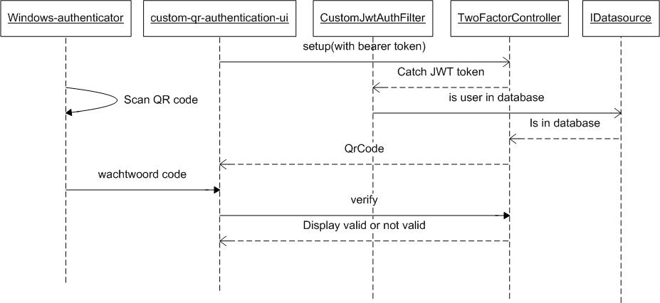

# Purpose
Sample to implement a custom Two-Factor Authentication with QR

## Project flow



## Implementation
### Gradle dependencies

``` groovy
    configurations.all {
        resolutionStrategy.eachDependency { details ->
            if (details.requested.group == 'com.beust' && details.requested.name == 'jcommander') {
                details.useVersion '1.78'
                details.because('Mitigates WS-2019-0490 security vulnerability')
            }
            if (details.requested.group.startsWith('com.fasterxml.jackson')) {
                if (details.requested.name == 'jackson-annotations') {
                    details.useVersion '2.21'
                } else {
                    details.useVersion '2.21.8'
                }
                details.because('Mitigates CVE-2026-110879 and aligns all Jackson modules to 2.21.8')
            }
        }
    }

	// two way authentication
	implementation 'dev.samstevens.totp:totp-spring-boot-starter:1.7.1'

	implementation 'io.jsonwebtoken:jjwt-api:0.13.0'
	implementation 'io.jsonwebtoken:jjwt-impl:0.13.0'
	implementation 'io.jsonwebtoken:jjwt-jackson:0.13.0'
```

## Configuration

``` java
/**
 * Configuratieklasse voor Two-Factor Authentication (TOTP).
 * Initialiseert de benodigde beans voor de 'dev.samstevens.totp' bibliotheek,
 * zoals secret generatie, QR-code generatie en code verificatie.
 */
@Configuration
public class TotpConfig {

    @Bean
    public SecretGenerator secretGenerator() {
        return new DefaultSecretGenerator();
    }

    @Bean
    public QrDataFactory qrDataFactory() {
        // SHA1 is de standaard voor de meeste 2FA apps
        // 6 is de standaard code lengte
        // 30 is de standaard tijd periode in seconden
        return new QrDataFactory(HashingAlgorithm.SHA1, 6, 30);
    }
    @Bean
    public QrGenerator qrGenerator() {
        return new ZxingPngQrGenerator();
    }

    @Bean
    public CodeVerifier codeVerifier() {
        TimeProvider timeProvider = new SystemTimeProvider();
        CodeGenerator codeGenerator = new DefaultCodeGenerator();
        return new DefaultCodeVerifier(codeGenerator, timeProvider);
    }
}
```


## Swagger
### URL swagger
http://localhost:8092/swagger-ui/index.html
